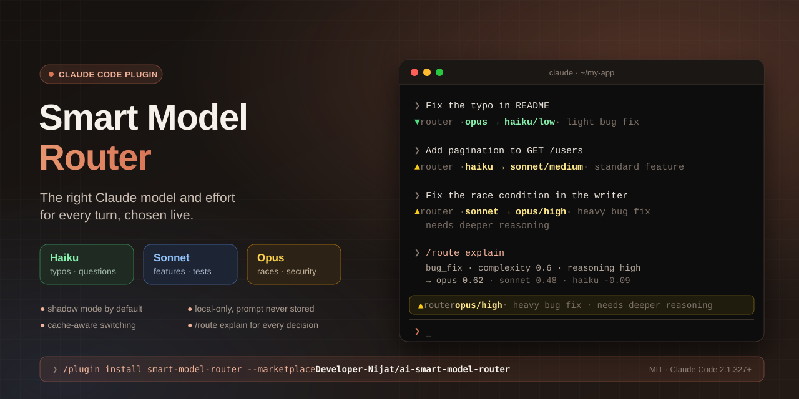

<div align="center">



# Smart Model Router

**Picks the right Claude model and reasoning effort for every Claude Code turn, automatically.**

A typo fix goes to Haiku, a feature to Sonnet, a race condition to Opus.<br>
You see each decision live, and one command puts you back in control.

[](https://github.com/Developer-Nijat/ai-smart-model-router/actions/workflows/ci.yml)
[](LICENSE)
[](#quick-start)


[Quick start](#quick-start) · [How it works](#how-it-works) · [Commands](#commands) · [Settings](#settings) · [Dashboard](#optional-local-daemon-and-dashboard) · [Privacy](#privacy-and-security)

</div>

---

## Why

Claude Code runs every turn on the same model. A typo fix on Opus costs as much as a system design on it, and a hard concurrency bug on Haiku costs you a wrong answer. Switching by hand is tedious and easy to forget.

Smart Model Router classifies each turn and each subagent task and scores the models you have against it. It then switches Claude Code to the cheapest model that fits, with the reasoning effort the task needs.

## Highlights

- **Per-turn and per-subagent routing.** Each turn gets its own model and effort, and a subagent is routed by its own task.
- **Live feedback in the terminal.** A coloured band above the prompt and a line in the transcript show each decision as soon as it is made.
- **Shadow mode by default.** It starts by only recommending, so you can watch it before you let it switch anything.
- **Aware of the prompt cache.** Switching models re-reads the context without the cache. The router prices that per model and does not flip back and forth.
- **Safe on hard work.** A high-risk or deep-reasoning task never stays on a model below the tier it needs.
- **Explainable.** `/route explain` shows the classification, every candidate's score, and why the winner won.
- **Private by default.** Routing runs on local rules. The prompt text is never stored or sent anywhere.
- **Optional local dashboard.** History, statistics, a cost comparison and your own routing rules, served on `127.0.0.1`.

## What it looks like

When a turn starts, the router shows what it chose and why:

```text
▼ router · opus → haiku/low · light bug fix · a cheaper model is enough
▲ router · sonnet → opus/high · heavy bug fix · needs deeper reasoning
■ router · staying on sonnet/medium · standard feature · switching would re-read the whole context
◇ router · would use haiku/low · light question · shadow mode, staying on opus
✎ router · override → sonnet/high · set with /route
⚑ router · rule → haiku/low · your rule docs-on-haiku
↳ router · subagent Explore → haiku/low · light analysis
```

The same message appears in a band above the prompt. Its colour shows the kind of change: green for a cheaper model, yellow for a stronger one. When the turn ends, the band dims to `last turn …`.

Decisions for sample prompts (router 0.1.0):

| Prompt | Routed to |
|---|---|
| `What is 17% of 2450?` | `haiku / low` |
| `Fix the typo in test.txt: Hello world should be Hello, world!` | `haiku / low` |
| `Rename the variable total to sum in calc.js` | `haiku / low` |
| `Create calc.js with a function that returns the average of an array` | `sonnet / medium` |
| `Create a small Express API with GET /users and POST /users` | `sonnet / medium` |
| `Find and fix the race condition when two POST /users requests write the file` | `opus / high` |
| `Review server.js for security vulnerabilities and fix injection risks` | `opus / xhigh` |

## Quick start

You need **Claude Code 2.1.327 or later**.

In Claude Code, install the plugin from this repository's marketplace:

```text
/plugin install smart-model-router --marketplace Developer-Nijat/ai-smart-model-router
```

Or in two steps:

```text
/plugin marketplace add Developer-Nijat/ai-smart-model-router
/plugin install smart-model-router@smart-model-router
```

Then:

```text
/route            # status: mode, override, last decision
/route auto       # let it switch models (it starts in shadow mode)
```

Work as usual. To get Claude Code's old behaviour back, run `/route off` or `/plugin disable smart-model-router@smart-model-router`.

## Commands

| Command | What it does |
|---|---|
| `/route` | Status: mode, manual override, last decision, daemon, rules |
| `/route auto` | Apply decisions: switch the model and effort for each turn |
| `/route shadow` | Only record recommendations; the session keeps its model (default) |
| `/route off` | Disable routing |
| `/route <model> [effort] [once]` | Manual override, e.g. `/route opus`, `/route sonnet high once` |
| `/route clear` | Remove the manual override |
| `/route explain` | Why the last turn got its model: classification, scores, alternatives |
| `/route stats` | Decisions, models used and estimated cost in this session |

Model names come from the registry: `haiku`, `sonnet`, `opus`, or full ids. An override applies even in shadow mode.

## How it works

```text
 prompt ─▶ classify ──▶ rules ──▶ score candidates ──▶ stay or switch ──▶ model + effort
           │            │         │                    │
           │            │         │                    └ a dearer model must win by a clear
           │            │         │                      margin; a cheaper one wins on score
           │            │         └ quality fit · cost · latency · switch cost
           │            │           (re-reading the context, priced per model)
           │            └ your own rules (optional): force a model, an effort, or no switching
           └ task type, complexity, reasoning, risk, scope: local rules
             (EN + AZ); an AI classifier is optional and off by default
```

1. **Classify.** Local, deterministic rules read the prompt for:
   - task type: bug fix, feature, refactor, security, architecture and others;
   - complexity, needed reasoning, risk and scope.

   Signals such as *trivial*, *mechanical*, *hard* or *destructive* raise or lower the complexity.
2. **Rules.** Your routing rules, if you have any, can pin a model or an effort for a kind of task.
3. **Score.** Each model Claude Code can use gets a score from four parts: quality fit, price, latency, and the cost of switching to it mid-session.
4. **Stay or switch.**
   - A stronger, dearer model has to win by a clear margin.
   - A cheaper model wins on score alone.
   - High-risk work always gets a model of the tier it needs.
5. **Apply.** The plugin sets the turn's model and effort through the Claude Code Mods API. It then records which model actually answered and how many tokens it used.

The routing core (`packages/core`) is a pure library with no side effects. The plugin, the CLI and the daemon all use it.

### Benchmark

An offline benchmark (`mr benchmark`) compares the router with always using one model. The prompts are hand-labelled with "the cheapest tier that does the task well". That label is a judgement, not a measurement.

| Strategy | Matches label | Under-powered | Over-powered | Price vs. always-Opus |
|---|---|---|---|---|
| **Router** | **30 / 30** | 0 | 0 | **0.51** |
| Always Haiku | 10 / 30 | 20 | 0 | 0.03 |
| Always Sonnet | 10 / 30 | 10 | 10 | 0.50 |
| Always Opus | 10 / 30 | 0 | 20 | 1.00 |

The rules were tuned on this set, so 30/30 is optimistic. A separate hold-out set of 12 prompts was labelled before tuning. On that set, the same changes raised the score from 6/12 to 10/12.

## Settings

Set these in Claude Code with `/plugin configure smart-model-router@smart-model-router`:

| Option | Values | Default | Meaning |
|---|---|---|---|
| `defaultMode` | `shadow`, `auto`, `off` | `shadow` | Mode a session starts in; `/route` changes it for the session |
| `liveMessages` | `on`, `band`, `off` | `on` | Transcript line and band, band only, or nothing |
| `privacyMode` | `local-only`, `local-ai`, `cloud-ai`, `hybrid` | `local-only` | Whether any classifier may see the prompt |
| `aiClassifier` | `off`, `on` | `off` | Ask Haiku about unclear prompts; needs `cloud-ai` or `hybrid` |
| `daemonUrl` | loopback URL | `http://127.0.0.1:4747` | Where decisions are recorded |
| `daemonToken` | token | none | From `mr init --show-token`; kept in Claude Code's secure storage |

The plugin works fully without a daemon. It keeps decisions in its own store and sends them once a daemon is available.

## Optional: local daemon and dashboard

The daemon does three things:
- records every decision in SQLite;
- serves your routing rules and scoring tuning to the plugin;
- hosts a web dashboard with history, statistics and a cost comparison.

```bash
git clone https://github.com/Developer-Nijat/ai-smart-model-router.git
cd ai-smart-model-router
npm ci
npm run build:dashboard

node apps/cli/bin/mr.js init --show-token   # config, token, database; prints the plugin settings
node apps/cli/bin/mr.js start               # daemon on 127.0.0.1:4747
node apps/cli/bin/mr.js dashboard           # opens the dashboard, signed in
node apps/cli/bin/mr.js doctor              # checks everything
```

Then give the plugin the token: run `/plugin configure smart-model-router@smart-model-router` and set `daemonToken`. Once the plugin is connected, `/route` shows `daemon: http://127.0.0.1:4747`.

The `mr` CLI also has `status`, `stop`, `history`, `stats`, `models`, `agents`, `rules`, `config`, `benchmark` and `uninstall`. See [docs/cli.md](docs/cli.md).

## Privacy and security

- **Local-only by default.** Classification uses local rules, so no prompt text leaves your machine for routing.
- **No prompt storage.** A decision keeps labels, scores and token counts, never the prompt. Live messages are built from labels only.
- **Loopback only.** The daemon listens on `127.0.0.1`. It authenticates the plugin with a bearer token and proves its own identity with an HMAC challenge.
- **Secrets readable by you alone.** The token file is `0600` on POSIX. On Windows its access list is narrowed to your account before the token is written.
- **Dashboard sign-in** uses a one-time code, valid for 60 seconds, that is exchanged for a session key. There are no cookies, and the dashboard has a strict Content Security Policy.
- **Costs are estimates** at dated list prices. On a subscription they are a comparison figure, not a charge.

## Requirements

| Component | Version |
|---|---|
| Claude Code | 2.1.327+ (Mods API) |
| Node.js | 22.13+ for the daemon and CLI (built-in `node:sqlite`); 22.22+ or 24 for development |
| OS | Windows, Linux, macOS |

## Development

```bash
npm ci
npm test               # unit, integration and contract tests (Vitest)
npm run coverage       # coverage report (threshold 80%)
npm run lint
npm run build:plugin   # rebuild plugins/smart-model-router from packages/claude-code-mod
```

The marketplace installs `plugins/smart-model-router`, which is built from `packages/claude-code-mod`. CI fails when the two differ. After changing the plugin, run `npm run build:plugin` and commit the result.

To try local changes in Claude Code without installing them:

```bash
npm run build:mod
claude --plugin-dir dist/claude-code-mod
```

CI runs lint, the tests with coverage, and the plugin check on Windows, Linux and macOS, with Node 22 and 24.

### Project layout

```text
.claude-plugin/            marketplace.json: this repository is a Claude Code marketplace
plugins/                   the built plugin the marketplace installs
packages/core/             pure routing core: classifier, rules, scoring, decide()
packages/claude-code-mod/  Claude Code plugin: routing glue (src/), hooks (mod-src/), build
packages/shared/           constants, errors, Zod schemas
packages/config/           data folders, config, token, Windows ACL
packages/storage/          node:sqlite, migrations, repositories
packages/adapters/         agent adapter contract; Claude Code adapter
packages/logger/           JSON logger that redacts secrets
apps/cli/                  the mr command
apps/server/               local daemon (Fastify): records, rules, dashboard API
apps/dashboard/            web dashboard (Vite + React + Tailwind)
data/                      model registry, dated prices, default rules, benchmark sets
docs/                      architecture, ADRs, integration notes
```

## Status and limitations

- **Version 0.1.0.** The core, plugin, CLI, daemon and dashboard are complete and tested. Interactive use has been checked by hand on Windows.
- **Claude Code only.** The adapter layer does not depend on one agent. It detects Codex CLI and Gemini CLI, but routing for them is not implemented yet.
- **Effort is not read back.** Claude Code does not report the effort a turn ran with, so the recorded effort is the one that was sent.
- **Fable is off by default.** To let the router use it, set its `status` in `data/models/anthropic.json` and rebuild the plugin.
- **macOS** is covered by CI but has not been tried by hand.

The design documents in `docs/` are written in Azerbaijani:
- [architecture](docs/architecture.md)
- [routing engine](docs/routing-engine.md)
- [Claude Code integration](docs/claude-code-integration.md)
- [CLI](docs/cli.md)
- [dashboard](docs/dashboard.md)
- [ADRs](docs/adr/README.md)

See also the [changelog](CHANGELOG.md).

## License

[MIT](LICENSE) © 2026 Nijat Aliyev
